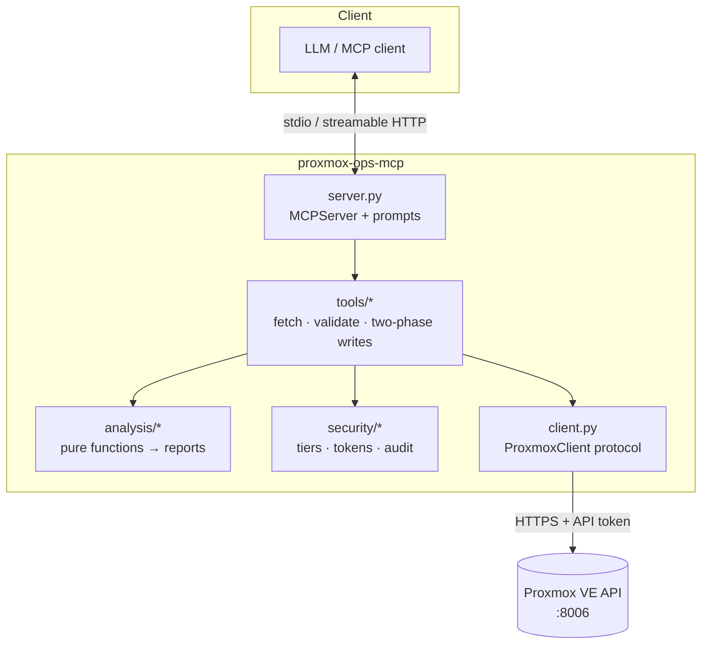

# Architecture

## Layers

| Layer | Responsibility | May do I/O? |
|---|---|---|
| `analysis/` | Turn raw API payloads into typed reports with findings | **No** |
| `tools/` | Fetch the payloads, call the analysis, apply the write protocol | Through `ProxmoxClient` only |
| `security/` | Tiers, confirmation tokens, audit log | Audit file only |
| `client.py` | Path validation and error mapping around `proxmoxer` | Yes |
| `server.py` / `cli.py` | Composition root and entry point | – |

## Design decisions

**Pure analysis functions.** Each diagnostic is a function from plain data to a pydantic
model. The logic that decides whether a backup is stale or a guest can migrate is
therefore deterministic, and it can be tested with JSON fixtures instead of a cluster.
Time is injected (`now` / `clock`) for the same reason.

**Protocol instead of a concrete client.** The tool layer depends on a two-method
`ProxmoxClient` protocol. Tests use an in-memory fake, and `proxmoxer` is imported in
exactly one module.

**Typed output everywhere.** Tools return pydantic models, so the MCP SDK publishes an
output schema and sends structured content. Clients can render results, and the model
does not have to parse free text.

**Stable finding codes.** `code` is part of the public contract. Thresholds and wording
may change, but codes only change with a major version. Users can build alerting and
suppression on top of them.

**Correlate server-side.** For example, `plan_node_evacuation` reads cluster resources,
every guest's configuration and the HA state in one call. Leaving that to the model
would cost dozens of round-trips and invite mistakes.

**Conservative planning.** The evacuation planner reserves each guest's *configured*
memory rather than its current usage. It treats anything it cannot prove migratable as a
blocker and never schedules HA-managed guests itself.

## Adding a diagnostic

1. Write a pure function in `analysis/` that returns a report with `findings`.
2. Unit-test it with fixtures in `tests/unit/`.
3. Add a thin tool in `tools/`, annotated with `READ_ONLY` and wrapped with `@guarded`.
4. Add an integration test in `tests/integration/test_server.py` and document the tool
   and its codes in `docs/tools.md`.

## Adding a write operation

Write operations need a strong reason (see [CONTRIBUTING.md](https://github.com/derdennis1012/proxmox-ops-mcp/blob/main/CONTRIBUTING.md)). They
must:

- be registered only for the lowest tier that is safe,
- go through `_run_two_phase` with *every* parameter that influences the effect,
- resolve the target guest and node on the server, never trust them from the model,
- validate preconditions in the preview, so that execution is boring,
- carry accurate `ToolAnnotations`.
